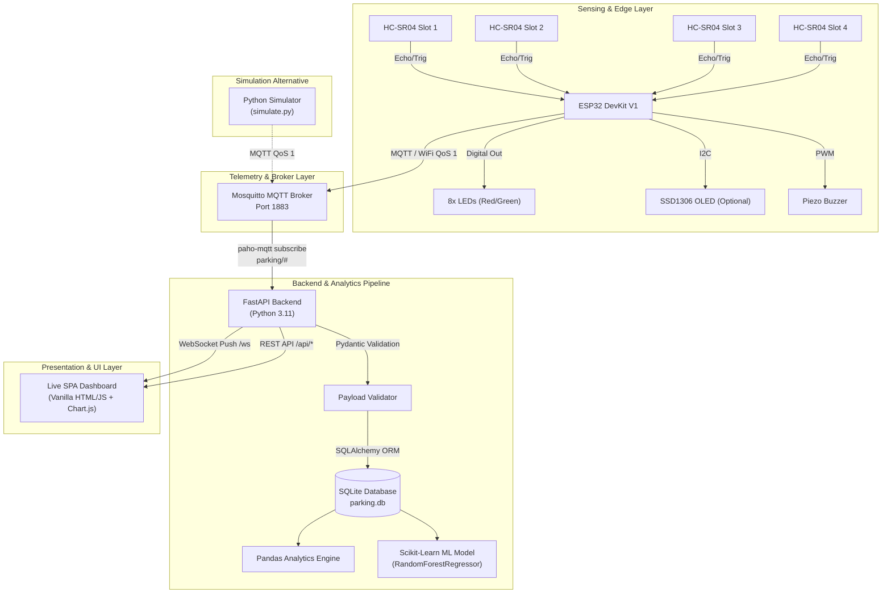
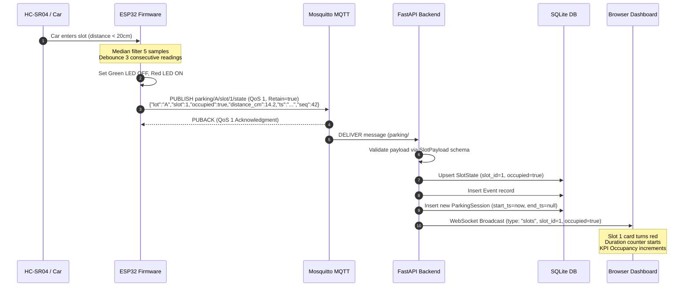
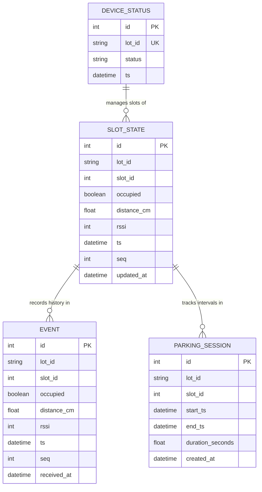
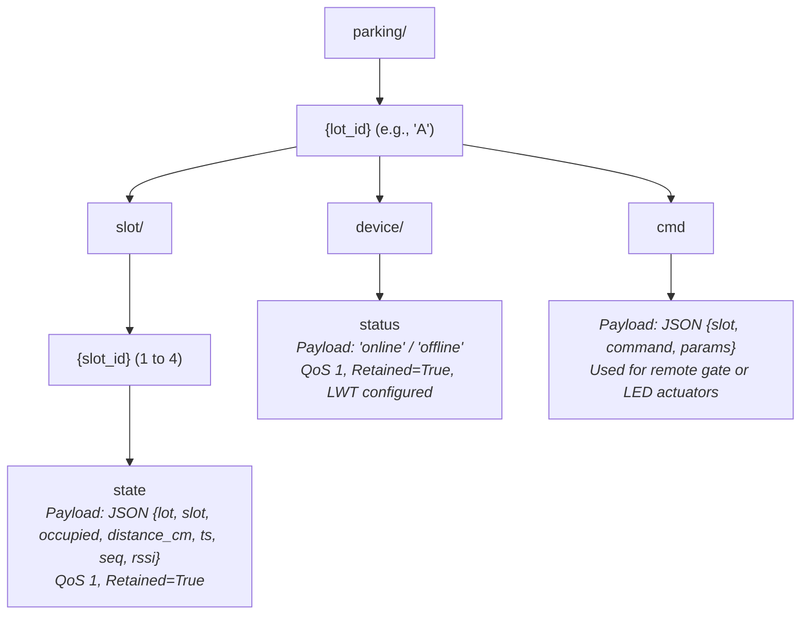

# System Architecture & Technical Specifications
**Project:** IoT-Based Smart Parking Occupancy Monitoring and Usage Pattern Analysis System  
**Course:** UE23CS342AA3 (Jackfruit Problem)  

---

## 1. High-Level System Block Diagram

---

## 2. End-to-End Data Flow Diagram

```mermaid
flowchart LR
    US["HC-SR04 Pulse"] -->|Echo Time| MED["5-Sample Median Filter"]
    MED -->|Filtered Distance| DEB["Debounce Logic<br/>(3 Consecutive Hits)"]
    DEB -->|State Flip?| LEDS["Local LED Update<br/>(Red/Green)"]
    DEB -->|JSON Serializer| JSON["Construct Payload<br/>lot, slot, ts, dist, seq, rssi"]
    JSON -->|MQTT Publish| PUB["Topic: parking/A/slot/{id}/state<br/>QoS 1, Retained"]
    PUB --> MOSQ["Eclipse Mosquitto"]
    MOSQ --> SUB["FastAPI paho Thread"]
    SUB --> PYD["Pydantic Schema Check"]
    PYD --> LOG["Insert Event Log"]
    LOG --> SESS["Derive Parking Session<br/>(Compute duration on exit)"]
    SESS --> WS["Broadcast via WebSocket"]
    WS --> UI["Update Slot Card & Charts"]
```

---

## 3. Sequence Diagram: Slot State Transition & WebSocket Broadcast

---

## 4. Database Entity-Relationship Diagram (ERD)

---

## 5. MQTT Topic Hierarchy & Routing Architecture

